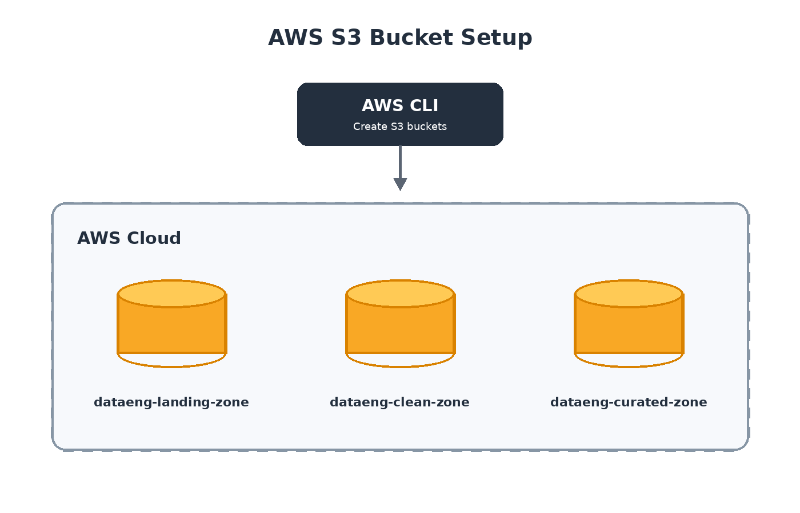
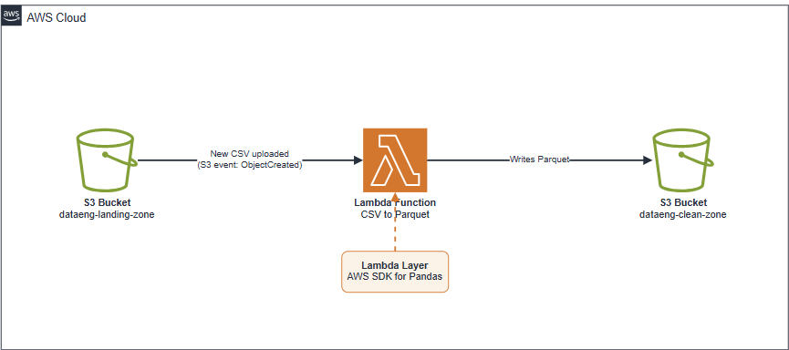

  
  &nbsp;&nbsp;&nbsp;&nbsp;
  <h1 align="center">Data Engineering with AWS</h1>

 

<h4>Step 1: Create S3 Buckets.</h4>

In this step we will create 3 Amazon S3 buckets for our project by using AWS CLI.

  

<h4>Step 2: CSV to Parquet</h4>

We will configure an S3 bucket to automatically trigger a Lambda function whenever a new file is written to the bucket. In the 
   Lambda function we're going to make use of an open-source Python library called AWS SDK for Pandas.

  

