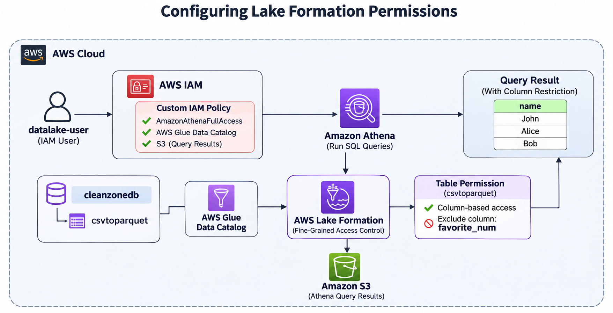
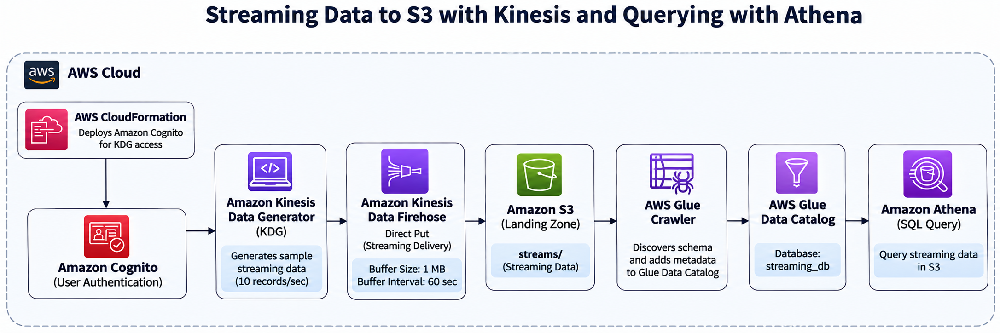
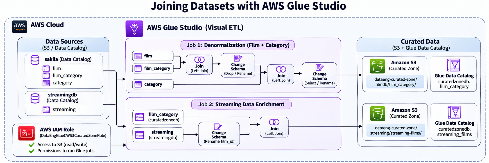
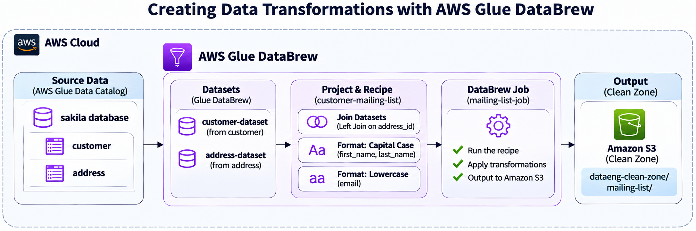
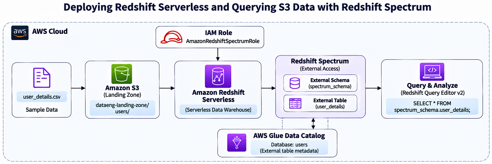
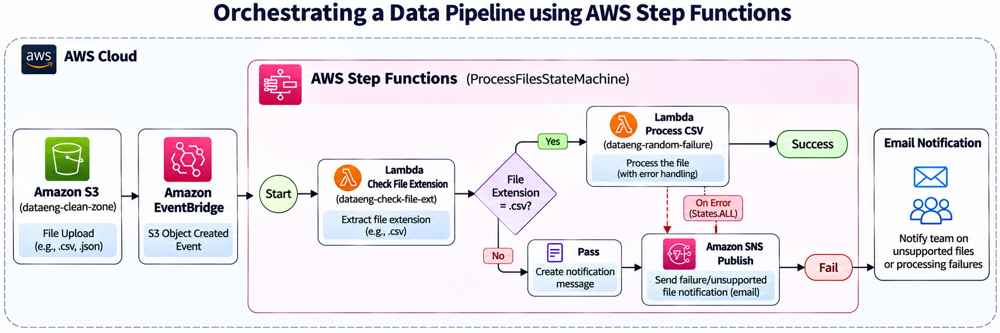

  
  &nbsp;&nbsp;&nbsp;&nbsp;
  <h1 align="center">Data Engineering with AWS</h1>

 

<h4>Step 1: Create S3 Buckets.</h4>

In this step we will create 3 Amazon S3 buckets for our project by using AWS CLI.

  

<h4>Step 2: CSV to Parquet</h4>

We will configure an S3 bucket to automatically trigger a Lambda function whenever a new file is written to the bucket. In the 
   Lambda function we're going to make use of an open-source Python library called AWS SDK for Pandas.

  

<h4>Step 3: Configuring Lake Formation permissions</h4>

Third step begins by creating a custom IAM policy based on AmazonAthenaFullAccess and attaching it to a new IAM user called datalake-user. An additional S3 bucket is created to store Athena query results. The user then verifies that they can query tables in the cleanzonedb database. Next, the transitions from IAM-based permissions to AWS Lake Formation permissions. This involves revoking IAMAllowedPrincipals permissions from the cleanzonedb database and its csvtoparquet table, allowing more granular access control through Lake Formation. Finally, column-level permissions are configured for datalake-user. By excluding the favorite_num column, the user can query the table through Athena but can only retrieve the name column.

  

<h4>Step 4: Replicating MySQL to an S3 Data Lake with AWS DMS</h4>

  This section demonstrates how to replicate data from an Amazon RDS MySQL database into an Amazon S3-based data lake using AWS Database Migration Service (DMS). First, AWS CloudFormation is used to deploy the MySQL database and an EC2 data loader. Next, IAM policies and roles are configured to grant AWS DMS permission to write data into the S3 landing-zone bucket. A DMS replication instance, source and target endpoints, and a migration task are then configured to perform a full load of tables from the MySQL sakila database into Amazon S3. Once the data is replicated, Amazon Athena is used to execute SQL queries directly against the data stored in S3, with query results saved to a separate S3 bucket. Finally, AWS resources are deleted to avoid unnecessary costs.

  

<h4>Step 5: Streaming data to S3 with Kinesis and Querying with Athena</h4>

  This step demonstrates how to build a serverless streaming data ingestion pipeline using Amazon Kinesis Data Firehose, Amazon S3, AWS Glue, and Amazon Athena. First, an Amazon Data Firehose delivery stream is configured with Direct PUT as the source and an Amazon S3 landing-zone bucket as the destination, using a 1 MB buffer size and a 60-second buffer interval. Next, AWS CloudFormation is used to deploy Amazon Cognito authentication for the Kinesis Data Generator (KDG), which generates and streams sample JSON records at a rate of 10 records per second into Firehose. The incoming data is automatically delivered to the S3 landing zone under the streams/ prefix. An AWS Glue Crawler is then configured with an IAM role to discover the schema of the newly ingested data and register its metadata in the AWS Glue Data Catalog under the streaming_db database. Finally, Amazon Athena is used to execute SQL queries directly against the streaming data stored in S3.

  

<h4>Step 6: Joining Datasets with AWS Glue Studio</h4>

It demonstrates how to build ETL pipelines using AWS Glue Studio to join, transform, and enrich datasets stored in an Amazon S3 data lake. First, a new database is created in the AWS Glue Data Catalog, and a custom IAM role is configured to grant Glue jobs the necessary permissions. Using AWS Glue Studio's visual ETL interface, data from the sakila database, including film, film_category, and category tables, is joined using left joins to create a denormalized dataset. Unnecessary columns are removed through Change Schema transformations, and the resulting data is stored in the Amazon S3 curated zone in Parquet format with Snappy compression, registered as the film_category table in curatedzonedb. Next, a second Glue ETL job enriches streaming data by joining the streaming table with the curated film_category dataset using film_id. The final enriched dataset is written to the S3 curated zone and registered as the streaming_films table.

  

<h4>Step 7: Creating data transformation with AWS Glue DataBrew</h4>

  Step seven demonstrates how to use AWS Glue DataBrew to clean, transform, and prepare customer data for a marketing mailing list. First, two datasets, customer and address, are created from the sakila database using tables registered in the AWS Glue Data Catalog. Next, a DataBrew project named customer-mailing-list is created with an IAM role to manage the necessary permissions. Using DataBrew's visual transformation interface, the customer and address datasets are combined through a left join on address_id, selecting only the columns required by the marketing team. A transformation recipe is then developed to standardize customer information by converting first_name and last_name to capital case and email addresses to lowercase. Finally, a DataBrew job named mailing-list-job is configured and executed to save the cleaned and transformed dataset to the Amazon S3 clean zone under dataeng-clean-zone/mailing-list/.

  

<h4>Step 8: Deploying Redshift Serverless and Querying S3 data with Redshift Spectrum</h4>

  This demonstrates how to use Amazon Redshift Serverless and Redshift Spectrum to query data stored directly in an Amazon S3 data lake without loading it into Redshift tables. First, a sample dataset named user_details.csv is uploaded to the dataeng-landing-zone/users/ S3 location. Next, a custom IAM role named AmazonRedshiftSpectrumRole is created with the necessary permissions and associated with a newly deployed Amazon Redshift Serverless environment. Using Redshift Query Editor v2, a connection is established to the default workgroup and the dev database. An external schema named spectrum_schema is then created, linked to a new users database in the AWS Glue Data Catalog. An external table is defined to reference the CSV data stored in S3, allowing Redshift Spectrum to access and query the dataset using standard SQL without physically importing it into Redshift. Finally, SQL queries are executed to verify that the external table is accessible and the data can be retrieved successfully.

  

<h4>Step 9: Orchestrating a data pipeline using AWS Step Functions</h4>

  It demonstrates how to build an event-driven data orchestration pipeline using AWS Step Functions, AWS Lambda, Amazon EventBridge, Amazon S3, and Amazon SNS. First, two Lambda functions are created: one to identify the file extension of incoming files and another to simulate processing with randomly generated failures. An Amazon SNS topic with an email subscription is then configured to send notifications when unsupported files or processing errors occur. Next, a Step Functions state machine named ProcessFilesStateMachine is developed to orchestrate the workflow using Lambda Invoke, Choice, Pass, Success, and Fail states. The state machine checks whether an incoming file has a .csv extension, processes supported files, and routes unsupported files or processing failures to SNS for email notification. Amazon EventBridge is then configured to automatically trigger the state machine whenever a new file is uploaded to the dataeng-clean-zone/chapter10/ S3 location. Finally, the pipeline is tested by uploading sample CSV files and monitoring execution results in Step Functions.

  

